# חומרי מוצר ותצוגה

מסמך זה נוצר מנתוני הקטלוג בפועל (`rpc_public_brand`) ומהמערכת שנבדקה. **אין בו המלצות, לקוחות, נתוני הצלחה או הבטחות שלא קיימות בקוד.** מחירים הם טיוטה עד אישור בלשונית "מותג".

## מה כלול בכל תבנית (עובדות שנבדקו)
- דף ציבורי בעברית ו-RTL, מותאם למובייל ולדסקטופ, עם ערכת עיצוב משלו.
- ממשק ניהול לבעל העסק: שירותים, הגדרות, מיתוג (צבע ומשפט), דומיין מותאם עם בדיקת DNS אמיתית.
- הפרדה בין עסקים והרשאות נאכפות במסד הנתונים (RLS), יומן פעולות ללא נתונים אישיים.
- הודעות SMS/WhatsApp: **לא פעילות** עד חיבור ספק. אישור ההזמנה מוצג באתר עם קישור אישי לניהול התור.

## מסלולים
### מנוהל
- אירוח ותפעול על ידינו
- הקמת העסק, השירותים והצוות
- גיבוי ומעקב תפעולי
- עדכוני מערכת

### חד-פעמי
- קוד המערכת והתקנה בחשבונות Supabase ו-Netlify של הלקוח
- מסמך העברה והוראות הפעלה
- ייצוא וייבוא נתוני העסק
- תחזוקה ועדכונים רק בהסכמה נפרדת

## תוספות (מחירי טיוטה)
- **חיבור דומיין מותאם** – הגדרת DNS ובדיקת חיבור (₪300)
- **התאמת מיתוג** – צבע מבטא ומשפט פתיחה בדף העסק (ללא עלות)
- **העברת נתונים קיימים** – ייבוא שירותים, לקוחות ותורים מרשימה קיימת (בהתאם למבנה הנתונים) (₪600)
- **חיבור ספק הודעות (SMS/WhatsApp)** – אינו פעיל כרגע: דורש חשבון אצל ספק הודעות; ללא ספק מחובר לא נשלחות הודעות (לפי הצעה)

## מספרות וברברשופ (`barbershop`)
**סוג:** הזמנת תורים  
**משפט:** מספרה שהלקוחות מזמינים אליה תור בלי להתקשר  
**תיאור:** מערכת הזמנת תורים למספרה: בחירת שירות וספר, שעות פנויות בזמן אמת, ויומן לבעל העסק. בעיצוב שחור-זהב.  
**מתאים ל:** מספרות, ברברשופ וסלוני גברים

**יכולות:**
- הזמנת תור אונליין ללא חשבון
- יומן ספרים ושעות עבודה
- קישור אישי לשינוי וביטול
- ניהול שירותים ומחירים

**בסיס להצגה:** עסק ההדגמה `/b/demo-barbershop` (נתונים סינתטיים; מוצג בו באנר הדגמה).  
**צילומי מסך:** 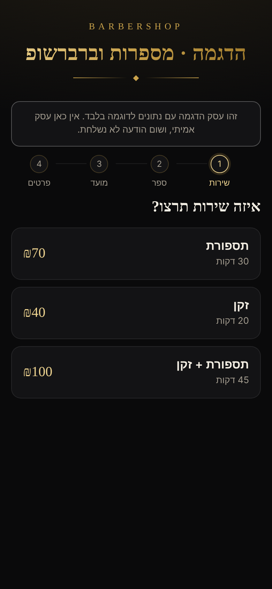 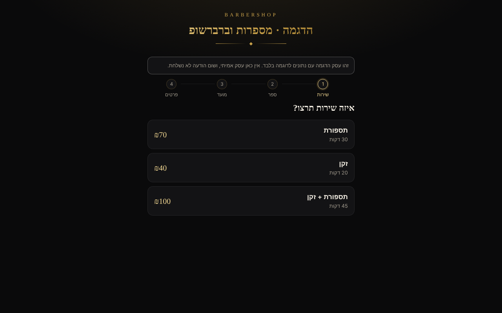

**אין לטעון:** שהמערכת מוכנה לייצור, שיש הודעות אוטומטיות, או נתוני לקוחות/הצלחה.

## קוסמטיקה, ציפורניים וריסים (`cosmetics`)
**סוג:** הזמנת תורים  
**משפט:** יומן טיפולים אלגנטי ללקוחות שאוהבות לקבוע מהנייד  
**תיאור:** מערכת הזמנת טיפולים לסטודיו ליופי: ציפורניים, ריסים וקוסמטיקה. כל מטפלת עם יומן משלה, ומשך טיפול לכל שירות.  
**מתאים ל:** קוסמטיקאיות, מניקוריסטיות, מעצבות ריסים וסטודיו ליופי

**יכולות:**
- הזמנת טיפולים אונליין, ללא חשבון
- מטפלות ושעות עבודה נפרדות
- משך טיפול לכל שירות, כולל טיפולים ארוכים
- קישור אישי לשינוי וביטול

**בסיס להצגה:** עסק ההדגמה `/b/demo-cosmetics` (נתונים סינתטיים; מוצג בו באנר הדגמה).  
**צילומי מסך:** 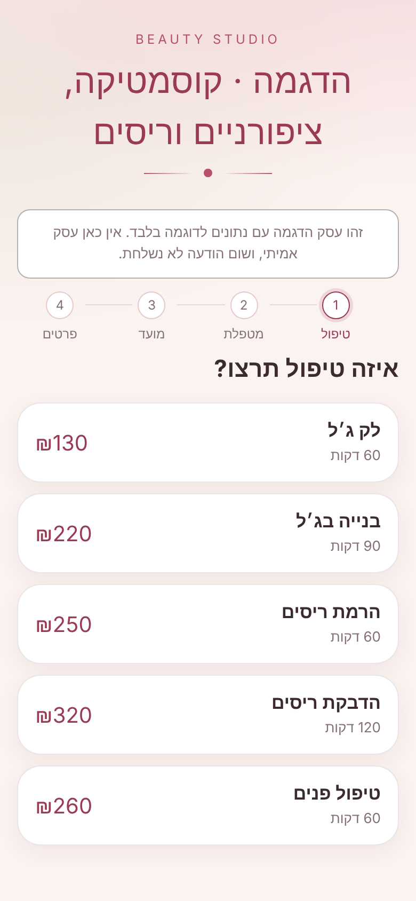 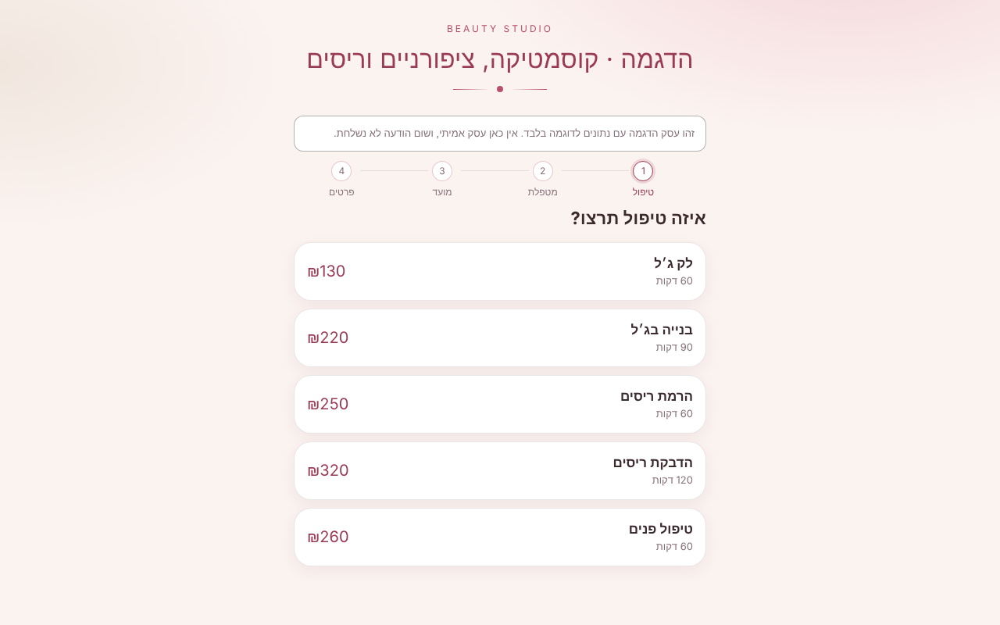

**אין לטעון:** שהמערכת מוכנה לייצור, שיש הודעות אוטומטיות, או נתוני לקוחות/הצלחה.

## דיטיילינג ושטיפת רכב (`detailing`)
**סוג:** הזמנת תורים  
**משפט:** חבילות טיפול, תחנות עבודה ויומן שמונע חפיפות  
**תיאור:** מערכת הזמנת תורים למכון טיפולי רכב: חבילות עם משך זמן, ותחנות עבודה שבהן כל תחנה תפוסה לאורך כל הטיפול.  
**מתאים ל:** דיטיילינג, שטיפות רכב, ציפוי קרמי וטיפולי פוליש

**יכולות:**
- חבילות טיפול עם משך ומחיר
- תחנות עבודה: כל תחנה עם יומן משלה
- טיפולים ארוכים חוסמים את התחנה לכל משכם
- קישור אישי לשינוי וביטול

**בסיס להצגה:** עסק ההדגמה `/b/demo-detailing` (נתונים סינתטיים; מוצג בו באנר הדגמה).  
**צילומי מסך:** 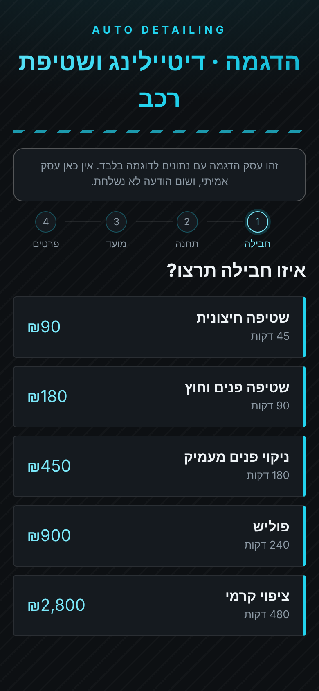 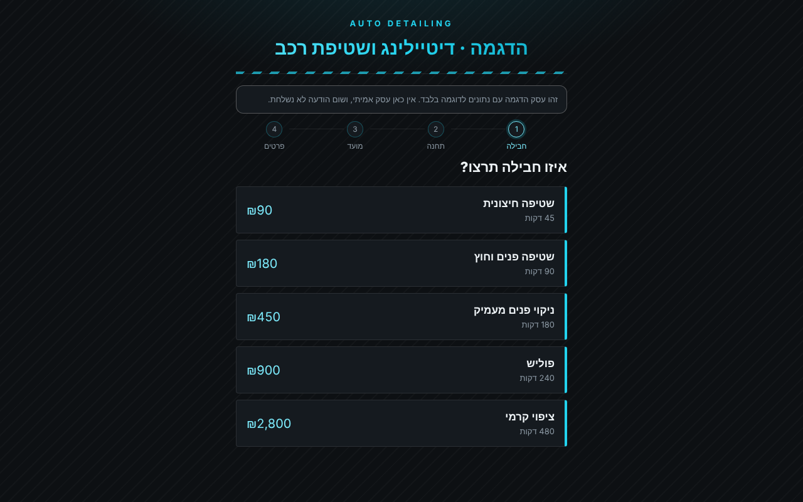

**אין לטעון:** שהמערכת מוכנה לייצור, שיש הודעות אוטומטיות, או נתוני לקוחות/הצלחה.

## בעלי מקצוע ושירותי בית (`home-services`)
**סוג:** קבלת פניות  
**משפט:** דף נחיתה שמביא פניות: אינסטלציה, חשמל, מיזוג ועוד  
**תיאור:** דף נחיתה לבעל מקצוע: שירותים, אזור שירות וטופס פנייה שכולל עיר ודחיפות. הפניות נשמרות ומופיעות אצל בעל העסק.  
**מתאים ל:** אינסטלטורים, חשמלאים, טכנאי מיזוג, שיפוצניקים ונגרים

**יכולות:**
- דף נחיתה מותאם לנייד
- טופס פנייה עם עיר ודחיפות
- ניהול פניות והתקשרות בלחיצה
- קטלוג שירותים ומחירים

**בסיס להצגה:** עסק ההדגמה `/l/demo-home-services` (נתונים סינתטיים; מוצג בו באנר הדגמה).  
**צילומי מסך:** 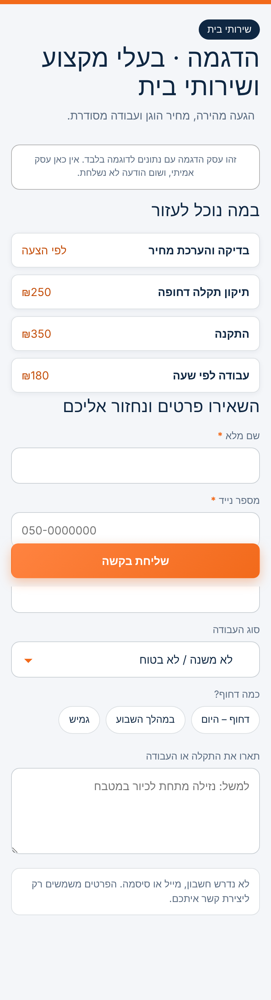 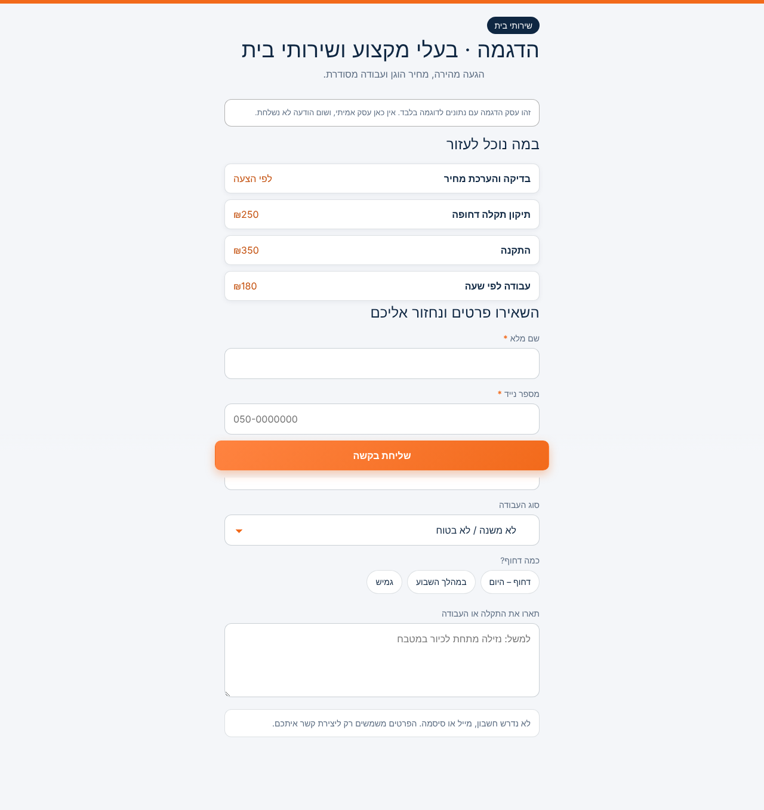

**אין לטעון:** שהמערכת מוכנה לייצור, שיש הודעות אוטומטיות, או נתוני לקוחות/הצלחה.

## נותני שירות וסטודיואים (`studio-services`)
**סוג:** קבלת פניות  
**משפט:** קטלוג שירותים ובקשת הצעת מחיר מסודרת  
**תיאור:** קטלוג שירותים ובקשת הצעת מחיר: הלקוח בוחר שירות, מציין תקציב ולוח זמנים, והבקשה נשמרת אצל בעל העסק.  
**מתאים ל:** צלמים, מעצבים, מאמנים, מטפלים, סטודיואים ויועצים

**יכולות:**
- קטלוג שירותים
- בקשת הצעת מחיר עם תקציב ולוח זמנים
- ניהול הבקשות בלשונית ייעודית
- עיצוב נקי ומובחן

**בסיס להצגה:** עסק ההדגמה `/l/demo-studio-services` (נתונים סינתטיים; מוצג בו באנר הדגמה).  
**צילומי מסך:** 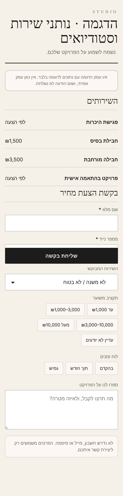 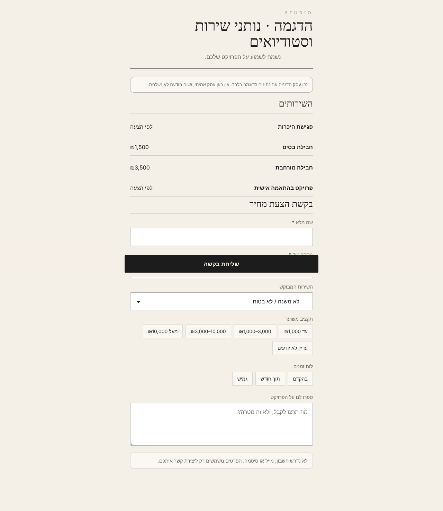

**אין לטעון:** שהמערכת מוכנה לייצור, שיש הודעות אוטומטיות, או נתוני לקוחות/הצלחה.

## אתר המותג
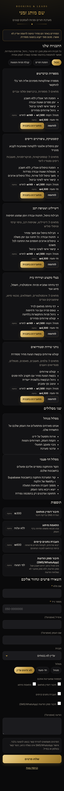
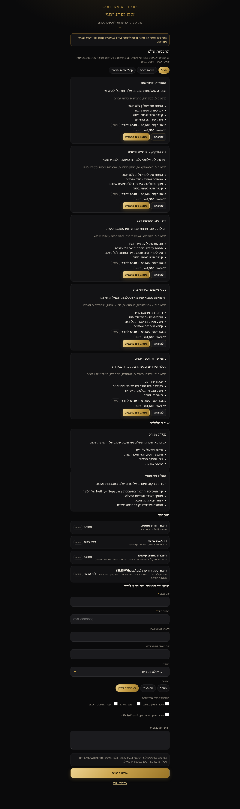
